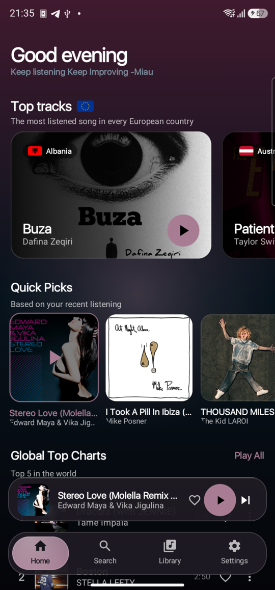
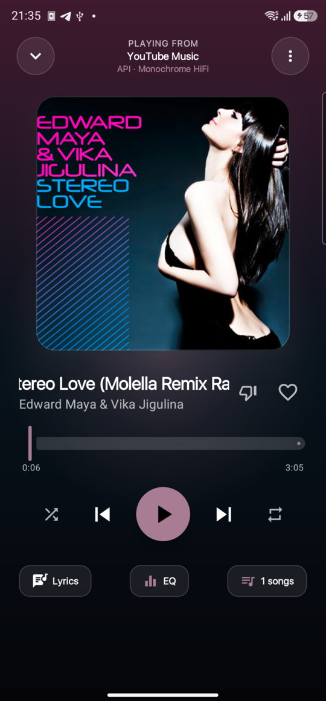
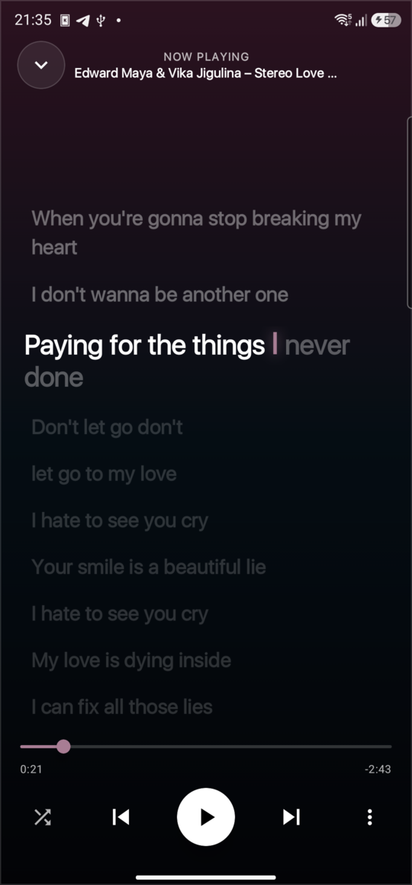
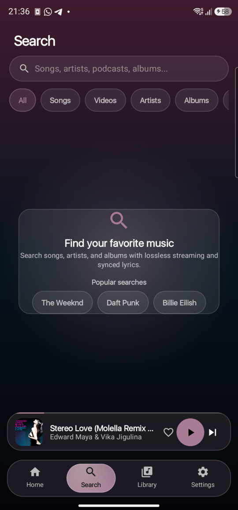

# LFly — Listen & Fly

**A native Android music player built with Kotlin and Jetpack Compose.**
Streams lossless / high‑fidelity audio from **Monochrome HiFi** and **YouTube Music**, with word‑level synced lyrics, background playback and a Liquid‑Glass UI.

<p>
  
  
  
  
  
</p>

> **Download:** grab the latest APK from the [**Releases**](https://github.com/Marianusus/LFly/releases/latest) page — or install directly:
>
> ```bash
> adb install -r "Sonora Version 1.3.apk"
> ```
>
> Android 8.0+ (API 26). Debug-signed build (package `org.sonora.android`). Full release notes: [CHANGELOG.md](CHANGELOG.md).

---

## Screenshots

| Home | Now Playing |
|:---:|:---:|
|  |  |

| Synced Lyrics | Search |
|:---:|:---:|
|  |  |

---

## Features

- **Lossless & high‑fidelity streaming** — resolves full‑length FLAC / high‑bitrate AAC from the **Monochrome HiFi** ecosystem with a rotating instance pool and health tracking (`ONLINE` / `DEGRADED` / `OFFLINE`) plus transparent failover.
- **No truncated previews** — the app always targets the complete track; 30‑second previews are only an emergency last resort.
- **Fast queue transitions** — asynchronous prefetch and on‑disk pre‑cache (`SimpleCache`) of the next track (N+1), so skipping in the queue is instant.
- **Personal Home shelf** — a swipeable 3×3 "quick access" grid mixing your most‑played tracks and playlists, plus an auto‑generated **On Repeat** playlist (deduplicated across providers, refreshed every 5 days).
- **Queue, autoplay, shuffle & repeat** — autoplay appends style/genre recommendations to keep the music going.
- **Track info sheet** — the ⋯ menu opens an Audio-Output-style panel with artwork, album, release year, duration, plays, source, type and all track actions; the player's menu exposes the same panel as **Information**.
- **Word‑level synced lyrics** — karaoke highlighting powered by Kugou (KRC) and LRCLIB, with **on‑device translation** via ML Kit.
- **Background & lock‑screen playback** — a Media3 `MediaSessionService` with notification controls, Quick Settings tiles, Bluetooth/headset buttons and album art.
- **Party — synchronized group listening** — start a session and nearby friends (Android + LFly) join by tapping the nearby list, a **QR code** or a **6‑character code**. Everyone hears the same track on their own headphones, with clock-synced playback, host-controlled guest permissions and a per-device headphone-delay nudge.
- **Discover** — European Top Charts, full YouTube Music search (songs / videos / artists / albums / playlists) with typeahead completions, cover-backed recent entities/queries and explicit search confirmation, plus rich artist pages.
- **Import** — Spotify playlist and data‑export importers.
- **Local music** — play audio you push to the device (see the helper script below).
- **Liquid‑Glass UI** — AMOLED black, 4 appearance modes, adaptive accent colour extracted from the album art, a refined artwork-first Home with uniform rails, a draggable BitChord-style bottom pill matched in height to the 64 dp mini player, with an immediate tap-lift animation, a gesture-driven mini player, an opt-in **real backdrop-sampled Liquid Glass chrome** (blur + lens on Android 12/13+) with animated now-playing fold/track transitions, and a Reduce‑Motion mode.
- **Now Playing V2** — full-bleed blurred artwork with the sharp cover dissolving into it, measured marquee titles, a word-by-word karaoke lyric strip with animated line changes, an inline queue that morphs the cover and the live track title into the header while keeping shuffle/loop/transport available, a BitChord-style track menu with artwork-tinted grouped actions and a metadata page (album/release year resolved from the album header), a compact long-press held menu with context actions, multi-artist credits with tappable names, offline lyric sidecars for downloads, a redesigned home with a resume hero that morphs away once playback starts, a three-page compact top-list shelf, a unified personal rail, Italy/Europe chart tabs and Liquid Glass cards when the setting is enabled, and a BitChord-style audio-output sheet with flat device rows, system volume, Equalizer/DSP and a dedicated Cast picker.
- **Localised** — Italian, English and Romanian.

## Tech stack

| Layer | Technology |
|---|---|
| Language | Kotlin |
| UI | Jetpack Compose, Material 3 |
| Media | Jetpack Media3 (ExoPlayer, `MediaSessionService`, `SimpleCache`) |
| Networking | OkHttp, Gson |
| Async | Kotlin Coroutines & Flow |
| Lyrics / translation | Custom lyrics engine, Kugou / LRCLIB providers, ML Kit Translate |

## Getting started

**Requirements:** JDK 17, Android SDK with `compileSdk 35`, and either Android Studio or the Gradle CLI.

```bash
# Build the debug APK
./gradlew assembleDebug

# Install it on a connected device
adb install -r app/build/outputs/apk/debug/app-debug.apk
```

> The application id is `org.sonora.android`.

### Optional: push local audio from your computer

`sonora-dl.sh` downloads a song from YouTube (via `yt-dlp`) and pushes it straight into the app's local library:

```bash
./sonora-dl.sh "https://youtu.be/xxxx"   # direct URL
./sonora-dl.sh "some song query"         # or a search query
```

It requires `yt-dlp` and `adb` on your `PATH`.

## Credits & Acknowledgements

- Lyrics engine adapted from **[sonorahq/sonora](https://github.com/sonorahq/sonora)** (GPL‑3.0), ported from Rust to Kotlin. LFly is an independent project and is **not affiliated** with it.
- The inline queue presentation and the bottom-chrome interaction are adapted from **[BitChord](https://github.com/kushagrasinghx/BitChord)** (GPL‑3.0).
- The backdrop/Liquid Glass engine is **[Kyant0/backdrop](https://github.com/Kyant0/backdrop)** (Apache‑2.0), integrated following BitChord/EchoMusic's glass glue (GPL‑3.0).
- Audio streaming uses the public **[Monochrome](https://monochrome.tf)** HiFi API endpoints — huge thanks to the Monochrome team.
- YouTube Music metadata/streams are accessed through the public InnerTube endpoints.

## Support

If you enjoy LFly and want to support its development:

- ❤️ **The developer** — [paypal.me/MRNASTE](https://www.paypal.me/MRNASTE)
- ☕ **Monochrome** (the HiFi API that makes lossless streaming possible) — [ko-fi.com/monochrometf](https://ko-fi.com/monochrometf)

## Disclaimer

LFly is an **unofficial**, personal/educational project and is **not affiliated** with YouTube, Google, Spotify, Monochrome or sonorahq. It does **not host or distribute** any audio content; it only resolves streams from third‑party sources. Use it responsibly and at your own risk.

**Permissions:** besides network access, the **Party** feature uses Bluetooth (scan/advertise/connect) and Wi‑Fi/nearby‑devices permissions — plus location on Android 11 and below — solely to discover and pair with nearby devices on your local network. No device location is collected or transmitted, and no audio is relayed between devices.

## License

Released under the **GNU General Public License v3.0** — see [`LICENSE`](LICENSE).

## Contact

Questions or issues? Open an issue or write to **Marianusus8@gmail.com**.
